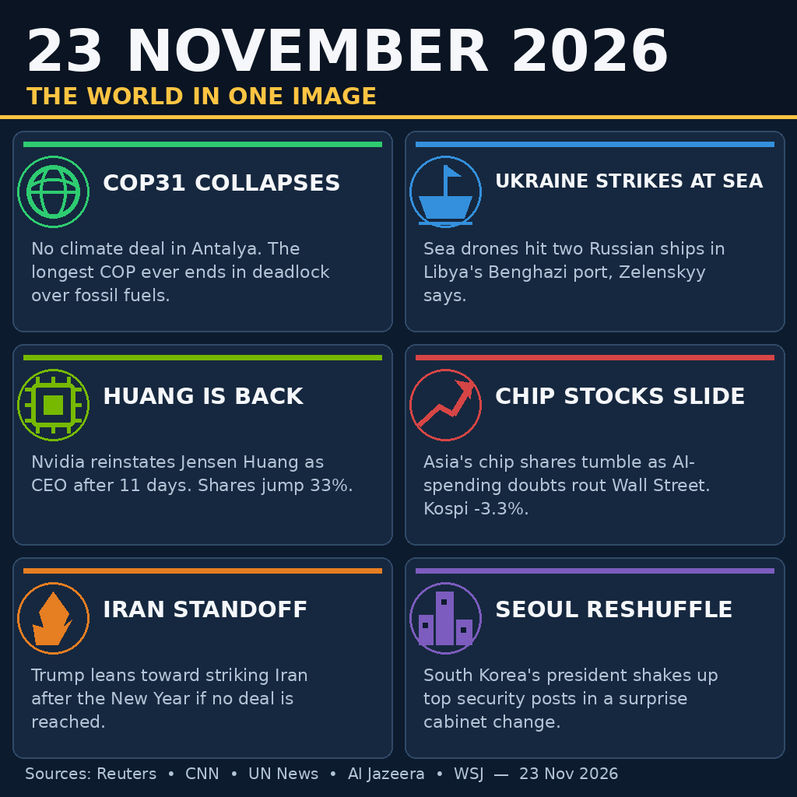

# 23 November 2026 — The World in One Image

[](https://make.fun/bounty/news-image-20261123?utm_source=github&utm_medium=readme&utm_campaign=news-image-20261123)
[](https://make.fun/bounty/news-image-20261123?utm_source=github&utm_medium=readme&utm_campaign=news-image-20261123)
[](https://make.fun/bounty/news-image-20261123?utm_source=github&utm_medium=readme&utm_campaign=news-image-20261123)

One image summing up Monday 23 November 2026 — drawn from scratch with Python (PIL shapes and text, no copied artwork).



## The day's stories

1. **COP31 collapses** — the UN climate talks in Antalya, Türkiye end with no deal, the longest COP in history, deadlocked over fossil fuels.
2. **Ukraine strikes at sea** — Ukrainian sea drones hit two Russian ships in Libya's Benghazi port, President Zelenskyy says.
3. **Huang is back** — Nvidia reinstates Jensen Huang as CEO after 11 days; shares jump 33% and the Nasdaq rallies 6%.
4. **Chip stocks slide** — Asian chip shares tumble as doubts over AI spending rout Wall Street; South Korea's Kospi closes down 3.3%.
5. **Iran standoff** — Trump says he is inclined to strike Iran after the New Year if no deal is reached; Tehran vows to confront the US naval blockade.
6. **Seoul reshuffle** — South Korea's president shakes up top national-security posts in a surprise cabinet change.

Full sources: see [SOURCES.md](SOURCES.md).

## Run it

```sh
mkdir -p out && MAKEFUN_OUTPUT_DIR=out python3 main.py
```

`main.py` copies `entry.png` to `$MAKEFUN_OUTPUT_DIR/entry.png` (default `/output`) and verifies the copy is byte-identical (SHA-256) to the source.

## Bounty

[news-image-20261123 on make.fun](https://make.fun/bounty/news-image-20261123?utm_source=github&utm_medium=readme&utm_campaign=news-image-20261123)

---

Built for the make.fun bounty — [join with my referral link](https://make.fun/?ref=9z8xfk3f).
